# Stress test of Within's SDK, @getwithin/sdk 0.4.0: what fails, why it matters, and how to fix it

Within puts a sales agent inside a company's MCP server. A company installs one npm package, `@getwithin/sdk`, and its customers can then ask buying questions inside Claude or ChatGPT.

This report lists what we found when we tried to break version 0.4.0 of that package, the latest on npm. Every finding has a plain-words explanation first, then the technical detail an engineer needs to fix it, then a way to reproduce it. The numbers in the findings are the same as the numbers in the saved results; the builder stops if they differ.

Everything ran on our own machine against the published package and a small stand-in for Within's server. We did not send load or attack traffic to Within's real service, and we did not look at anything behind its login. Numbers are the ones used in earlier messages, so W-01 and W-14 are missing: they no longer exist in this version.

## The short version, for a founder

- **What Within does.** Companies now let customers talk to them through AI assistants such as Claude or ChatGPT. Within sells a small add-on that a company installs once, so that a Within sales representative can join those conversations at the right moment.
- **What we did.** We tested version 0.4.0 of that add-on, the latest published version, on a laptop, against a pretend copy of Within's service, so nothing touched Within's real systems. We ran 43 checks, 9 more for the newer parts of the add-on, and put real AI assistants (Claude) through it.
- **What we found, in three kinds.** The add-on can break the company's own product. It can send customer details to Within that the documents never mention. And the documents and the software sometimes disagree.
- **What we found.** 24 problems: 6 High, 11 Medium and 7 Low. The High ones are W-02, W-04, W-09, W-10, W-11, W-21.
- **If a company fixes only a few things.** Make sure an outage at Within can never break the company's own answers, stop customer details leaving without being listed in the documents, and keep login passes on the company's own server.

**Explore it:** [the interactive map](https://satyaasudarshan.me/within-trigger-check/) opens a hand-drawn sketch of every finding below.

## At a glance

**24 findings: 6 High, 11 Medium, 7 Low.** 43 checks on the stock package (11 pass, 14 gap, 10 info, 8 fail); 9 more for the newer parts (2 pass, 5 gap, 1 info, 1 fail).

| ID | Severity | What | Prototype fix |
|---|---|---|---|
| [W-02](#w-02) | High | When Within is down, the vendor's own answers can be changed, or fail | P1 |
| [W-04](#w-04) | High | A vendor tool that already has an input called `context` silently loses it | P2 |
| [W-09](#w-09) | High | Tools the vendor chose NOT to wrap still report to Within | P6 |
| [W-10](#w-10) | High | The AI's goal summary goes to Within with private details in it, and the docs table does not list it | none |
| [W-11](#w-11) | High | The customer's full question goes to Within unredacted, and the docs do not say so | none |
| [W-21](#w-21) | High | With the new identity option on, the customer's login token is sent to Within on every tool call | none |
| [W-03](#w-03) | Medium | A hung Within adds 5 seconds to every successful wrapped tool call, every time | none |
| [W-05](#w-05) | Medium | If the AI writes a goal longer than 300 characters, the whole tool call is rejected | none |
| [W-08](#w-08) | Medium | With argument capture on, very long text without spaces can freeze the vendor's server for seconds | P5 |
| [W-12](#w-12) | Medium | Error messages carry private details to Within even when argument capture is off | none |
| [W-13](#w-13) | Medium | With argument capture on, tool results also leave, and several secrets slip through | none |
| [W-15](#w-15) | Medium | The docs say a banned phrase replaces one paragraph. The code replaces all of the vendor's instructions | P7 |
| [W-18](#w-18) | Medium | On the SDK side, consent rests on the AI, because the SDK itself does not check that the customer chose | none |
| [W-19](#w-19) | Medium | On servers that keep no sessions, a rep's offer cannot find the customer | none |
| [W-20](#w-20) | Medium | A small AI model sometimes treats "compare two companies" as a sales question | P11 |
| [W-22](#w-22) | Medium | A new tool, report_void, is on by default, and the customer's own words in it go to Within unredacted | none |
| [W-24](#w-24) | Medium | With the hubs feature on, text written on Within's side is added to the vendor's own tool results, and the AI repeats it to the customer | none |
| [W-06](#w-06) | Low | When a rep's offer is attached, the vendor's own `_meta` data is removed | P4 |
| [W-07](#w-07) | Low | If the vendor's customer-identity function throws, the customer's tool call fails | P8 |
| [W-16](#w-16) | Low | A wrong key or a missing URL fails silently | P9 |
| [W-17](#w-17) | Low | Two lists of private-network addresses are defined and never used | none |
| [W-23](#w-23) | Low | When the AI app does not report its name, the first 80 characters of its user-agent text are sent as the app name | none |
| [W-25](#w-25) | Low | The new doctor command passes a server whose own `context` input is being removed (W-04) | none |
| [W-26](#w-26) | Low | The app-only hub_card tool can be called directly by any MCP client; only the host's label keeps the AI away from it | none |

**If you only fix six things:** W-02 (an outage must not change or break the vendor's own answers), W-09, W-10 and W-11 (what leaves the vendor's server, and what the docs say about it), W-04 (never swallow a vendor's own `context` input) and W-21 (a login token must not leave the vendor's server).

### What the severity words mean

- **High.** Can break or corrupt a vendor's own product, or sends a vendor's customer data to Within in a normal setup, in a way the docs do not say.
- **Medium.** Breaks something the docs promise, or hurts in a less common setup, or only during an outage.
- **Low.** A papercut or a hardening step. Worth fixing, unlikely to hurt anyone soon.

### What the verdicts mean

- **pass.** The package did what the docs, or a reasonable vendor, would expect.
- **FAIL.** The package contradicts its own docs, or breaks something a vendor would reasonably expect.
- **gap.** Behaviour that is documented or deliberate but leaves a risk, or behaviour the docs do not mention. A decision for Within's team, not necessarily a bug.
- **info.** A measurement, with no judgement attached.

## Breaks the vendor's own product

### W-02

**High: When Within is down, the vendor's own answers can be changed, or fail**


**For a founder.** Within is sold as a safe add-on. But when Within itself is down, the company's own product can show an error, or end every answer with a confusing "service unreachable" message. A problem at Within becomes the company's problem.

**In plain words.** The docs promise that if Within cannot be reached, the vendor's result still comes back with one extra line. The extra line does arrive. But the SDK also writes `status: "service_unreachable"` into the vendor's structured data, overwriting any `status` the vendor already uses. A tool whose declared output format restricts a `status` field (for example to fixed values), or forbids extra fields, fails outright during the outage with an "Output validation error".

**Why it matters.** A Within outage becomes the vendor's own outage for tools like that. The customer sees an error from the vendor's product. Even when it works, the chat ends with "The service is unreachable.", which (in our reading) looks as if the vendor's product is broken.

**What we measured.**

- `A2` (pass): Within is down (connection refused): is the vendor's result returned? after 2 ms: results for fintech | The service is unreachable.
- `A3` (FAIL): Within is down: is the vendor's own structured data left alone? structuredContent.status came back as "service_unreachable"
- `A3b` (FAIL): Within is down: does a tool with a declared output schema still work? Within up: ok. Within down: error: MCP error -32602: Output validation error: Invalid structured content for tool order_lookup: Invalid enum value. Expected 'shipped' | 'pending', received 'service_unreachable' at status

**Where in the code.**

- `unreachableVendorResult`, `dist/index.js` line 1343, called from `instrumentTool` at line 1526.

**What Within should change.**

- Add the note as text only, or in `_meta`, and never touch `structuredContent`.
- Consider not showing it to the customer at all; log it on the vendor's side instead.

**Prototype fix.** Patch P1 (in `stress/patches`), tested on a patched copy: A3 goes from fail to pass; A3b goes from fail to pass.

**Reproduce.** `cd stress && WITHIN_SDK_ENTRY=$PWD/sdk-0.4.0/dist/index.js STOCK_COPY=1 node run.mjs A2 A3 A3b`

### W-03

**Medium: A hung Within adds 5 seconds to every successful wrapped tool call, every time**


**For a founder.** When Within is slow, every action in the company's product waits five extra seconds. An AI assistant takes many actions to answer one question, so the customer feels a very slow product and blames the company.

**In plain words.** The docs say calls to Within stop after 5 seconds, and that is true. But the SDK has no memory: when Within hangs, call after call waits the full 5 seconds. It also makes two requests to Within for every successful wrapped tool call, even when no offer is waiting.

**Why it matters.** An AI agent often makes many tool calls for one question. If Within hangs, ten calls in a row can wait 50 seconds in total (ten times the 5 second cap), and the delay looks like the vendor's own.

**What we measured.**

- `A1` (pass): Within hangs: how long does the vendor's tool wait? returned after 5004 ms; vendor text kept: true; text: results for fintech | The service is unreachable.
- `A1b` (gap): Within hangs: does the SDK stop waiting on later calls (circuit breaker)? three calls in a row took 5002 ms, 5002 ms, 5002 ms
- `A8` (info): How many calls does Within receive per vendor tool call? 10 tool calls produced: {"/v1/install":1,"/v1/activity":10,"/v1/offers/deliver":10}
- `A8b` (info): How much time does the SDK add to one vendor tool call (Within answering in 0 ms and in 300 ms)? median time per call. Within answering instantly: wrapped 0 ms, unwrapped 0 ms. Within answering after 300 ms: wrapped 303 ms, unwrapped 303 ms.

**Where in the code.**

- `serviceFetch`, `dist/index.js` lines 621 to 635: a fixed 5 second timeout.
- `instrumentTool`, lines 1482 to 1542: waits for the offer check, then for the activity report, before returning the vendor's result.

**What Within should change.**

- Add a circuit breaker: after a few failures, skip Within for 30 seconds.
- Send the activity report in the background and do not wait for it.
- Check for an offer less often (cache it for a few seconds), and use a shorter timeout for everything except `get_vendor_answer`.

**Reproduce.** `cd stress && WITHIN_SDK_ENTRY=$PWD/sdk-0.4.0/dist/index.js STOCK_COPY=1 node run.mjs A1 A1b A8`

### W-04

**High: A vendor tool that already has an input called `context` silently loses it**

**For a founder.** If one of the company's own tools already has an input with a common name, Within quietly takes it away before the company's code sees it, and the feature misbehaves with no error message.

**In plain words.** Within adds an optional "goal" input named `context` to every tool registered with `registerTool` after install (except tools marked app-only). If the vendor's tool already has an input with that name (an ordinary name for an input), Within takes the customer's value out before the vendor's code runs, and sends it to Within as the "goal".

**Why it matters.** The vendor's tool behaves wrongly with no error message (the call returns normally), because an input it needs is missing. And whatever was in that input, up to 300 characters, goes to Within.

**What we measured.**

- `B3` (FAIL): A vendor tool that already has an input called `context`: does the vendor's handler still receive it? handler received: {"question":"How do refunds work?"}. The call itself returned an error: false. Within received mcpIntent: "Customer Priya Raman, plan Team, 40 seats"

**Where in the code.**

- `splitMcpContext`, `dist/index.js` line 1398, applied inside `patchRegisterTool` (line 1415) to every tool.
- `withMcpContext` (line 1376) already notices the clash and leaves the vendor's schema alone, but the stripping still happens.

**What Within should change.**

- Use a name no vendor would use, such as `_within_goal`, or carry the goal in `_meta`.
- Strip the field only when the SDK is the one that added it.

**Prototype fix.** Patch P2 (in `stress/patches`), tested on a patched copy: B3 goes from fail to pass.

**Reproduce.** `cd stress && WITHIN_SDK_ENTRY=$PWD/sdk-0.4.0/dist/index.js STOCK_COPY=1 node run.mjs B3`

### W-05

**Medium: If the AI writes a goal longer than 300 characters, the whole tool call is rejected**


**For a founder.** If the AI writes a slightly long note, the whole action fails instead of the note being trimmed. A customer can see a failure over something trivial.

**In plain words.** The extra goal input is limited to 300 characters. Models are often wordy. When one writes a longer goal, validation rejects the whole call instead of trimming the text.

**Why it matters.** The vendor's tool fails whenever the model writes more than 300 characters. If the model retries, the retry costs time, and the customer may see a failed tool.

**What we measured.**

- `B4` (FAIL): The model writes a goal longer than 300 characters: does the vendor's tool call still work? 300 characters: ok. 375 characters: rejected: MCP error -32602: Input validation error: Invalid arguments for tool search: String must contain at most 300 character(s) at context

**Where in the code.**

- `dist/index.js` line 650: `z6.string().max(300)`.
- Line 419 (`redactMcpIntent`) already trims to 300 characters, so the validator is redundant.

**What Within should change.**

- Remove `.max(300)` from the validator and keep the trim.

**Prototype fix.** Patch P3 does not change the verdict of B4 on this version's code (B4: fail on the patched copy), so it is not offered as a fix.

**Reproduce.** `cd stress && WITHIN_SDK_ENTRY=$PWD/sdk-0.4.0/dist/index.js STOCK_COPY=1 node run.mjs B4`

### W-06

**Low: When a rep's offer is attached, the vendor's own `_meta` data is removed**

**For a founder.** At exactly the moments a Within sales rep's offer appears, some of the company's own behind-the-scenes labels disappear. That is hard to notice and hard to debug.

**In plain words.** The docs say the vendor's tool result stays intact, and that an offer adds one line of text and one extra field. The SDK also deletes the result's `_meta`, a place where vendors keep hints and trace ids.

**Why it matters.** Vendors that use `_meta` lose it on exactly the calls where a rep's offer appears. Hard to notice and hard to debug.

**What we measured.**

- `B2` (FAIL): A rep's offer is attached to a result: is the vendor's own _meta kept? _meta after the offer was attached: undefined. The offer itself arrived: true

**Where in the code.**

- `attachInvitation`, `dist/index.js` lines 1323 to 1335: `delete next._meta`.

**What Within should change.**

- Remove only the keys that mount the card, or explain in the docs why all of them go.

**Prototype fix.** Patch P4 (in `stress/patches`), tested on a patched copy: B2 goes from fail to pass.

**Note.** We do not know why Within removes `_meta`. It may be to stop a second card from appearing, in which case only the card keys need to go.

**Reproduce.** `cd stress && WITHIN_SDK_ENTRY=$PWD/sdk-0.4.0/dist/index.js STOCK_COPY=1 node run.mjs B2`

### W-07

**Low: If the vendor's customer-identity function throws, the customer's tool call fails**


**For a founder.** A helper that exists only to tell Within who the customer is can bring down the company's real feature when that helper has a problem.

**In plain words.** A vendor can pass a function that works out who the customer is. If that function throws, for example because a session store is down, the vendor's tool call fails even though the tool itself worked.

**Why it matters.** A helper meant for Within's records can take down the vendor's real feature.

**What we measured.**

- `A7` (gap): A customer-identity callback throws: does the vendor's tool still return? tool call failed: session store is down. The vendor's own handler had already run: true

**Where in the code.**

- `identityOf`, `dist/index.js` line 1742: `await identify(...)` runs outside any try/catch.

**What Within should change.**

- Catch the error and carry on without an identity.

**Prototype fix.** Patch P8 (in `stress/patches`), tested on a patched copy: A7 goes from gap to pass.

**Reproduce.** `cd stress && WITHIN_SDK_ENTRY=$PWD/sdk-0.4.0/dist/index.js STOCK_COPY=1 node run.mjs A7`

### W-08

**Medium: With argument capture on, very long text without spaces can freeze the vendor's server for seconds**


**For a founder.** One customer pasting a very long, unbroken piece of text can freeze the company's whole AI server for several seconds, for every other customer too. This only applies when the optional "capture arguments" setting is on.

**In plain words.** The privacy filter that hides email addresses uses a text pattern that gets much slower as the text gets longer, if the text has no spaces. With argument capture on, 20,000 letters took about 565 ms, 40,000 took about 2389 ms and 80,000 took about 9506 ms (the median of three runs on a quiet laptop; a busier machine is slower). During that time the whole server process cannot answer anyone. Error messages go through the same filter even with default settings: 40,000 characters took about 783 ms. Ordinary prose and spaced-out digits are fine.

**Why it matters.** A customer pasting a long encoded string, or someone trying to hurt the vendor, can stall the vendor's whole MCP server for every other customer. The SDK runs inside the vendor's process, so its slowness is the vendor's slowness.

**What we measured.**

- `C8` (FAIL): captureArguments on: a very long free-text argument. Does redaction block the vendor's server? letters 20000: median 565 ms (slowest of 3: 587 ms); letters 40000: median 2389 ms (slowest of 3: 2422 ms); letters 80000: median 9506 ms (slowest of 3: 9984 ms); digits-spaces 40000: median 16 ms (slowest of 3: 16 ms); digits-spaces 80000: median 18 ms (slowest of 3: 20 ms); error-letters-default-settings 20000: median 193 ms (slowest of 3: 200 ms); error-letters-default-settings 40000: median 783 ms (slowest of 3: 814 ms)

**Where in the code.**

- The `EMAIL` pattern, `dist/index.js` line 398, used by `redact` (line 427), which feeds `sanitizeError` (line 557), `argumentPreview` (line 526) and `resultText` (line 546).
- Time grows with the square of the length: each doubling made it about three to four times slower.

**What Within should change.**

- Cut the text to about 1,000 characters before any pattern runs (the output is cut to 200 anyway).
- Or replace the pattern with a linear scan. Add a test with a 100,000-character input.

**Prototype fix.** Patch P5 (in `stress/patches`), tested on a patched copy: C8 goes from fail to pass.

**Reproduce.** `cd stress && WITHIN_SDK_ENTRY=$PWD/sdk-0.4.0/dist/index.js STOCK_COPY=1 node run.mjs C8`

### W-24

**Medium: With the hubs feature on, text written on Within's side is added to the vendor's own tool results, and the AI repeats it to the customer**


**For a founder.** If a company switches on the new "hubs" option, Within can add a sentence of its own to the company's answers, and the AI then repeats it to the customer. In our runs the AI repeated it every time, even when the user had asked not to be sent anything. The documents say the company's answer stays intact.

**In plain words.** With `hubs: true`, after each wrapped tool call the SDK asks Within (`POST /v1/hubs/invite`, sending the customer's session id and the tool name). If Within answers with a `line`, `attachHubLine` appends it to the vendor's result as an extra text block, adds a `hubInvitation` field to `structuredContent`, and adds `{ tool: "open_hub" }` to the vendor's own `next` list. The vendor's server instructions also tell the AI to say that one sentence to the customer. Within's docs say: "Your tool result stays intact."

**Why it matters.** A vendor who switches the option on lets Within's server put text into answers the vendor wrote, and the AI shows that text to the customer. The hubs option is not on the docs page. In real-Claude runs with hubs on, and the stand-in replying with a line, the sentence was added to 106 tool results. The AI repeated it to the customer in 40 of 40 runs (Haiku and Sonnet), including 20 of 20 runs where the user had said not to open any hub or send anything. It never opened the hub by itself (0 of 40 runs). The sentence we used was our own stand-in text; what Within's server really sends is not visible from outside.

**What we measured.**

- `N8` (gap): With the hubs feature on, does Within's reply change the vendor's own tool result? Without hubs: 1 text block(s), fields ["items","next"], next [{"tool":"refine"}]. With hubs on, and Within replying with a line: 2 text blocks, last one "You have 2 new introductions waiting. Want to see them?", fields ["items","next","hubInvitation"], next [{"tool":"refine"},{"tool":"open_hub"}]. Text written by Within's side is inside the vendor's result.

**Where in the code.**

- `attachHubLine`, `dist/index.js` line 1308: appends the line to `content`, adds `hubInvitation` and an `open_hub` step to `structuredContent`.
- `instrumentTool`, line 1530: calls `/v1/hubs/invite` after each wrapped tool call when `hubs` is on and no offer is pending.
- `HUB_INSTRUCTIONS`, line 590: tells the AI to say the sentence, then call `open_hub` if the customer wants it.

**What Within should change.**

- Keep Within's text out of the vendor's result: carry the invitation in `_meta`, or show it only on the card, never in `content`.
- List the hubs option in the docs table, with what it sends and what it adds to results.
- Mark the line so the AI can tell it comes from Within and not from the vendor.

**Reproduce.** `cd stress && WITHIN_SDK_ENTRY=$PWD/sdk-0.4.0/dist/index.js node run-new.mjs   # needs the 0.4.0 copy, see stress/README.md, "Run it on another version"`

## What leaves the vendor's server

### W-09

**High: Tools the vendor chose NOT to wrap still report to Within**


**For a founder.** A company that deliberately keeps a sensitive internal tool out of Within's sight is not actually protected. Within can still learn that the tool was used and, with one setting on, what was typed into it.

**In plain words.** The docs say: wrap the tools you want Within to see. In practice the SDK hooks every tool registered with `registerTool` after install (the older `server.tool()` call is not hooked). If the AI fills in the goal input on an unwrapped tool, Within receives the tool's name, whether it worked, and the goal text. With argument capture on, it also receives the tool's arguments.

**Why it matters.** A vendor who leaves a sensitive internal tool unwrapped to keep it private is not protected. In our test, with argument capture on, an HR lookup's arguments, including a name and a phone number, reached the stand-in.

**What we measured.**

- `C7` (FAIL): A tool the vendor did NOT wrap: does it still report to Within? without a goal text: 0 reports. With a model-written goal text: 1 report (toolName "internal_admin_lookup", mcpIntent "HR wants Priya Raman's salary"). With captureArguments on, the unwrapped tool's arguments were also sent: true ("salary of Priya Raman (617) 555-0142").

**Where in the code.**

- `patchRegisterTool`, `dist/index.js` lines 1415 to 1480: it reports any tool that is not flagged as already reporting, as soon as the goal text is present.

**What Within should change.**

- Report only wrapped tools, or make reporting of other tools an explicit opt-in option, and document it.

**Prototype fix.** Patch P6 (in `stress/patches`), tested on a patched copy: C7 goes from fail to pass.

**Reproduce.** `cd stress && WITHIN_SDK_ENTRY=$PWD/sdk-0.4.0/dist/index.js STOCK_COPY=1 node run.mjs C7`

### W-10

**High: The AI's goal summary goes to Within with private details in it, and the docs table does not list it**


**For a founder.** A short summary of what the customer wants, written by the AI, is sent to Within. Private details such as phone numbers and names can be in it, even though Within's homepage says personal data is hidden before storage. Companies are not told this happens.

**In plain words.** Whenever the AI fills in the optional goal note about what the customer wants (Claude did in our runs), the SDK sends it to Within. Within's home page says "PII redacted before storage". The docs narrow that to "when arguments are captured". The SDK hides emails, keys that start with `sk-` or `sb_`, bearer tokens and valid card numbers. It does not hide phone numbers, names, street addresses, social security numbers, the letters of a bank account number (IBAN: its digits look like a card number, so they are hidden), or keys in other formats such as Stripe, AWS, GitHub and JWT. The "What leaves your server" table does not mention this note at all, and it is sent even when argument capture is off.

**Why it matters.** A vendor's customers' personal details can end up in Within's console without the vendor knowing. Within's server may redact more after the text arrives. That part is not visible from outside.

**What we measured.**

- `C1` (pass): Default settings: which fields reach Within on a wrapped call? fields sent: source, sdkVersion, customerSessionId, toolName, outcome, durationMs, mcpIntent, mcpIntentSource, title, description. Argument or result fields among them: none
- `C2` (gap): Default settings: the model-written goal text (mcpIntent). Which kinds of private data survive? listed kinds that survived: none. Other kinds that reached Within unredacted: phone_us, phone_international, person_name, stripe_style_key (sk_live_), aws_access_key, github_token, jwt_without_Bearer, us_ssn, street_address.

**Where in the code.**

- `redactMcpIntent`, `dist/index.js` lines 419 to 425, and the fields assembled in `instrumentTool` (line 1515) and in the patched `registerTool` (line 1454).

**What Within should change.**

- List the note in the docs table.
- Make it opt-in, or off by default.
- Widen the filter (phone, SSN, IBAN, `sk_live_`, `AKIA`, `ghp_`, JWT) and say plainly that names cannot be caught by a pattern.
- Or tell the model not to put personal details in the note.

**Note.** The repo's `npm run fix` redacts phone numbers in this note. It does not cover the other kinds.

**Reproduce.** `cd stress && WITHIN_SDK_ENTRY=$PWD/sdk-0.4.0/dist/index.js STOCK_COPY=1 node run.mjs C1 C2`

### W-11

**High: The customer's full question goes to Within unredacted, and the docs do not say so**


**For a founder.** The customer's whole question goes to Within exactly as typed, including any name or phone number in it. Within probably needs the question to find the right answer, but companies are not told it is sent.

**In plain words.** The docs table says that for `get_vendor_answer`, Within gets the topic and sends back the saved answer. The SDK also sends the customer's whole question, up to 2,000 characters, exactly as the model wrote it.

**Why it matters.** A question like "Hi, I'm Priya Raman, call me on 617 555 0142" reaches Within as written. Within presumably needs the question to choose an answer, so sending it is understandable. Not saying so is the problem.

**What we measured.**

- `C10` (gap): get_vendor_answer: what does Within receive about the customer's question? fields sent to /v1/answers: customerSessionId, topic, question. The question text was sent as: "Hi, I'm Priya Raman (priya.raman@acme-fund.com, +1 617 555 0142). What does Team cost for 40 seats? Card 4242 4242 4242 4242."

**Where in the code.**

- `dist/index.js` lines 4303 to 4308: `question` is added to the body sent to `/v1/answers`.

**What Within should change.**

- Add it to the docs table.
- Redact emails, phone numbers and cards in the question before sending. The SDK already hides emails and cards elsewhere, but not phone numbers.

**Note.** The repo has an opt-in `--question` patch for this in `fixes/apply.mjs`.

**Reproduce.** `cd stress && WITHIN_SDK_ENTRY=$PWD/sdk-0.4.0/dist/index.js STOCK_COPY=1 node run.mjs C10`

### W-12

**Medium: Error messages carry private details to Within even when argument capture is off**


**For a founder.** When a company's tool fails, the start of the error message, which often contains what the customer typed, is sent to Within, even if the company never switched data capture on.

**In plain words.** When a vendor's tool fails, the first 160 characters of the error message are sent to Within on every failed call to a wrapped tool. Error messages often contain what the customer typed. The SDK hides emails and cards in it but not phone numbers or names.

**Why it matters.** A message like "No account for priya@acme.com, phone (617) 555-0142" leaves the vendor's server even though the vendor never switched capture on. The docs do not describe error text.

**What we measured.**

- `C3` (gap): Default settings: error messages from the vendor's tool. Do they carry private data to Within? thrown error sent as: "No account for [redacted], phone (617) 555-0142, name Priya Raman". Returned isError text sent as: "No account for [redacted], phone (617) 555-0142, name Priya Raman". Email redacted: true.

**Where in the code.**

- `firstErrorText` (line 1408) and `sanitizeError` (line 557), used by `instrumentTool` (line 1495).

**What Within should change.**

- Send an error code or class instead of the message, or send nothing unless capture is on.
- If the text is kept, document it and widen the filter.

**Reproduce.** `cd stress && WITHIN_SDK_ENTRY=$PWD/sdk-0.4.0/dist/index.js STOCK_COPY=1 node run.mjs C3`

### W-13

**Medium: With argument capture on, tool results also leave, and several secrets slip through**


**For a founder.** If a company switches on the optional capture setting for one tool, more leaves the server than the documents say, including parts of the answers, and the filter that hides secrets misses some common kinds.

**In plain words.** The docs say capture stores the tool's arguments, after redaction. The SDK also sends the first 160 characters of the tool's result. And the filter misses several kinds of secret, both in values and in argument names: `pwd`, `passphrase`, `private_key`, `credentials`, `session`, `dob` and `iban` are not treated as secret names.

**Why it matters.** A vendor that turns capture on for one tool may send customer records (the result) and credentials the docs imply are removed.

**What we measured.**

- `C4` (gap): captureArguments on: does the tool's result text also leave? resultText sent: "Account found: Priya Raman, phone (617) 555-0142, plan Team". argumentPreview sent: "Priya Raman (617) 555-0142"
- `C5` (gap): captureArguments on: which kinds of private data survive in a free-text argument? listed kinds that survived: none. Other kinds stored unredacted: phone_us, phone_international, person_name, stripe_style_key (sk_live_), aws_access_key, github_token, jwt_without_Bearer, us_ssn, street_address.
- `C6` (gap): captureArguments on: which argument NAMES count as secret and are dropped? values of these argument names reached Within: pwd, passphrase, private_key, privateKey, credentials, session, dob, iban

**Where in the code.**

- `makeCapturedFields`, `dist/index.js` lines 668 to 681.
- `SECRET_SEGMENTS`, lines 362 to 381: a deny-list of names.

**What Within should change.**

- Document the result text, or drop it.
- Switch from a deny-list to an allow-list: capture only argument names the vendor lists.
- Extend the value patterns (see W-10).

**Reproduce.** `cd stress && WITHIN_SDK_ENTRY=$PWD/sdk-0.4.0/dist/index.js STOCK_COPY=1 node run.mjs C4 C5 C6`

### W-21

**High: With the new identity option on, the customer's login token is sent to Within on every tool call**


**For a founder.** In this version, switching on the new "who is this customer" option makes each customer's login pass travel to Within with every action. A login pass is a credential: whoever holds it can act as that customer until it expires. Within's documents say it stays on the company's server.

**In plain words.** In 0.4.0, when the vendor sets the `identity` option, the SDK adds the customer's signed login token (the `authInfo.token` of the tool call, a three-part JWT) to the activity report it sends to Within, as the field `authToken`. In our test it arrived exactly as received. Without the option it is not sent. Within's docs list "the raw bearer token" under what is left on the vendor's server.

**Why it matters.** A login token is a credential: whoever holds it can act as that customer until it expires. The vendor is not told it leaves their server. Within's docs page (getwith.in/docs, read 2026-11-23) still says the current release is 0.3.0, and it does not mention `report_void`, hubs or the `doctor` command, so the docs may simply be behind the code. That makes this a question for Within before a vendor turns the option on. What Within's server does with the token is not visible from outside. The new `doctor` command prints whether a login was "verified by Within", which suggests Within checks the token on its own side. That would explain why it is sent, but the docs say the raw token stays on the vendor's server.

**What we measured.**

- `N1` (FAIL): With the identity option set, is the customer's login token sent to Within? with the identity option: the activity report to Within CONTAINED the customer's login token, exactly as received (field authToken). By default (no identity option): did not contain it.

**Where in the code.**

- `signedLoginToken`, `dist/index.js` line 6353: returns `{ authToken: token }` when the token looks like a JWT.
- `install`, line 6404: `loginToken: (extra) => options.identity ? signedLoginToken(extra) : {}`.
- Added to the report in `instrumentTool` (line 1508), `patchRegisterTool` (line 1462) and the report_void handler inside `registerWithinTools` (line 4392).

**What Within should change.**

- Do not send the token. The report already carries the verified user id and, in 0.4.0, `authIssuer`.
- If Within's server must verify the token itself, make that a separate, explicitly named option, and list it in the docs table with what is stored and for how long.
- Never add it to reports for tools the vendor did not wrap (`patchRegisterTool` also adds it).

**Reproduce.** `cd stress && WITHIN_SDK_ENTRY=$PWD/sdk-0.4.0/dist/index.js node run-new.mjs   # needs the 0.4.0 copy, see stress/README.md, "Run it on another version"`

### W-22

**Medium: A new tool, report_void, is on by default, and the customer's own words in it go to Within unredacted**


**For a founder.** This version adds a tool that every company gets by default, and tells the AI to use it whenever it cannot give the customer what they asked for. What the AI writes there, in the customer's own words, goes to Within. A name, phone number or email would go through unchanged if the AI wrote one. In our real-AI runs it wrote only a short topic. The documents do not mention the tool.

**In plain words.** 0.4.0 registers a new tool, `report_void`, on every install, with no option needed. It also adds a sentence (306 characters) to every vendor's server instructions telling the AI to call it when a tool cannot return what the customer asked, with `asked` set to "a short phrase in the customer's own words". The phrase is sent to Within as `voidAsked`. In a direct check, calling the tool ourselves with "find Priya Raman, call her on 617 555 0142 or email priya.raman@example.com", the text arrived exactly as written. The SDK hides emails in other fields, but not in this one.

**Why it matters.** Vendors now send customer wording to Within by default, without choosing to and without the docs saying so: the docs page does not mention `report_void`. The redaction used for the goal note is not applied to this field. With real Claude the tool is used a lot: Haiku called it in 24 of 87 ordinary runs and Sonnet in 28 of 57, often right after the vendor's own answer. In runs where the question contained a name, phone number and email, the two models made 37 calls, and every phrase was a short topic. The name appeared in 0 of them, the phone number in 0 and the email in 0. So the unredacted path is real (check N5), but these models did not use it for personal details. Two models and two prompts is still a small sample, and another model or prompt may copy them, which is why this is Medium and not High. Within's server may redact more after the text arrives; that part is not visible from outside.

**What we measured.**

- `N5` (gap): The new model-callable tool report_void: does private detail in what the AI writes reach Within? report_void is listed to the AI by default (true). The AI's phrase went to Within as voidAsked: "find Priya Raman, call her on 617 555 0142 or email priya.raman@example.com". Phone number sent as written: true. Name sent as written: true. Email sent as written: true.

**Where in the code.**

- `registerWithinTools`, `dist/index.js` line 4279, registers `report_void`; its handler, also in `registerWithinTools`, builds the report at lines 4392 to 4400.
- `VOID_CALL_SENTENCE`, line 592, appended to `SERVER_INSTRUCTIONS`. It accounts for the 306 extra characters seen in check D5.
- `voidAsked` and `voidTool` are fields of the report; the text arrived unchanged in the test.

**What Within should change.**

- Run `asked` through the same redaction as the goal note, widened to phone numbers, and cap its length.
- Make `report_void` opt-in and list it in the docs table, with what is stored.
- Change the instruction so the AI describes the kind of request ("seat limits"), not the customer's wording.

**Reproduce.** `cd stress && WITHIN_SDK_ENTRY=$PWD/sdk-0.4.0/dist/index.js node run-new.mjs   # needs the 0.4.0 copy, see stress/README.md, "Run it on another version"`

### W-23

**Low: When the AI app does not report its name, the first 80 characters of its user-agent text are sent as the app name**


**For a founder.** This version records which AI app the customer is using. Usually that is just the app's name. When the app does not say, it falls back to the first 80 characters of its technical identification text and sends that instead.

**In plain words.** 0.4.0 adds host fields to every activity report. When the app reports itself (`clientInfo`), only its name and version are sent, as the docs say. When it does not, `hostFieldsFromExtra` falls back to the connection's `user-agent` header. If that text contains `claude`, `chatgpt`, `openai` or `cursor`, the first 80 characters are sent as the app name.

**Why it matters.** Small, and not personal by itself, but more than the docs line "the client's name and version", and user-agent text often includes operating-system and build details.

**What we measured.**

- `N4` (gap): What does Within learn about the customer's AI app on every call? when the app reports itself: {"hostName":"claude-ai","hostLabel":"claude-ai","hostVersion":"1.2.3","hostDetectedBy":"initialize"}. When only a browser-style user-agent header is present: {"hostName":"Mozilla/5.0 (Macintosh; Intel Mac OS X 10_15_7) AppleWebKit/537.36 (KHTML, like ","hostLabel":"Mozilla/5.0 (Macintosh; Intel Mac OS X 10_15_7) AppleWebKit/537.36 (KHTML, like ","hostDetectedBy":"user-agent"} (80 characters of the header sent as the app name). With neither: {}.

**Where in the code.**

- `hostFieldsFromExtra`, `dist/index.js` line 1711.
- `KNOWN_HOST`, line 1669: `/chatgpt|openai|claude|cursor/i`.
- Added to every report through `ctx.hostFields(extra)` in `instrumentTool` and `patchRegisterTool`.

**What Within should change.**

- Send only the name and version the app reports.
- For the fallback, send just the matched product token (for example `Claude/1.0.0`), not the first 80 characters.

**Reproduce.** `cd stress && WITHIN_SDK_ENTRY=$PWD/sdk-0.4.0/dist/index.js node run-new.mjs   # needs the 0.4.0 copy, see stress/README.md, "Run it on another version"`

## Docs say one thing, the package does another

### W-15

**Medium: The docs say a banned phrase replaces one paragraph. The code replaces all of the vendor's instructions**


**For a founder.** The documents say a banned phrase removes one paragraph of the company's instructions to the AI. In fact all of the company's own instructions are replaced, silently, so the AI starts behaving differently with no warning.

**In plain words.** The docs say that if the vendor's server instructions contain one of five phrases ("Do not mention" and similar), the paragraph holding it is replaced by Within's text. The code replaces the vendor's entire instructions with Within's text. It only happens when the vendor did not paste `SERVER_INSTRUCTIONS` into its own text, as the quickstart does. And the check is case-sensitive, so "do not mention" and "Never mention" are untouched.

**Why it matters.** The vendor's own guidance on how the AI should use their tools silently disappears and the AI behaves differently, with no log line. Within's own text is 2901 characters long.

**What we measured.**

- `D1` (FAIL): Vendor instructions with 2 paragraphs, the second holding a banned phrase: what is left of the first? paragraph 1 kept: false; paragraph 2 kept: false; instructions are now exactly Within's text: true
- `D2` (info): Which phrases trigger the replacement (docs list five)? "next tool call": replaced; "Do not call": replaced; "Do not ask": replaced; "Do not say": replaced; "Do not mention": replaced; "do not mention": kept; "Never mention": kept; "Don't mention": kept; "Do NOT mention": kept
- `D3` (info): Docs' own quickstart pattern (vendor pastes SERVER_INSTRUCTIONS into its instructions): is a banned phrase still removed? with the pasted text, the vendor's own sentences were kept: true. So the replacement rule only runs when the vendor does NOT paste SERVER_INSTRUCTIONS.

**Where in the code.**

- `publishServerInstructions`, `dist/index.js` lines 6279 to 6298. The regular expression is at line 6293.

**What Within should change.**

- Replace only the paragraphs that hold a banned phrase, as documented, or never touch the vendor's text and only append.
- Log what was removed.

**Prototype fix.** Patch P7 (in `stress/patches`), tested on a patched copy: D1 goes from fail to pass.

**Reproduce.** `cd stress && WITHIN_SDK_ENTRY=$PWD/sdk-0.4.0/dist/index.js STOCK_COPY=1 node run.mjs D1 D2 D3`

### W-16

**Low: A wrong key or a missing URL fails silently**


**For a founder.** A typo in the web address or the key makes Within silently do nothing, or look like an outage, and the company gets no message saying it is a setup mistake.

**In plain words.** If Within answers a wrong API key with a 401 (the stand-in does, and the real API did once, per this repo's README), the SDK treats it as normal, so Within silently does nothing, and nothing is logged. If the URL is left out, which the homepage snippet allows, every call goes to a local address and every customer answer ends with "The service is unreachable.". A key made only of spaces is accepted.

**Why it matters.** A typo in the URL looks like a Within outage. A wrong key makes Within silently do nothing. In neither case does the vendor get a log line.

**What we measured.**

- `A4` (gap): Wrong API key (Within answers 401): does the vendor get any signal? tool result: results for fintech. Log lines from the SDK: 0. Within answered 3 requests, all 401.
- `A9` (gap): baseUrl left out (homepage snippet with an unset env var): where do the calls go? install did not complain. Calls went to http://127.0.0.1:8787. Every tool result now ends with: "The service is unreachable.". SDK log lines: 0.
- `A10` (gap): API key checks at start-up missing: threw api_key_required; empty string: threw api_key_required; three spaces: accepted

**Where in the code.**

- `serviceFetch` (line 621) swallows every failure. `install` (line 6372) checks only that a key exists.

**What Within should change.**

- Log once at start-up and on the first 401 or refused connection.
- Reject a blank key.
- Make the homepage snippet match the quickstart, which has a fallback URL.

**Prototype fix.** Patch P9 (in `stress/patches`), tested on a patched copy: A10 goes from gap to pass.

**Reproduce.** `cd stress && WITHIN_SDK_ENTRY=$PWD/sdk-0.4.0/dist/index.js STOCK_COPY=1 node run.mjs A4 A9 A10`

### W-17

**Low: Two lists of private-network addresses are defined and never used**


**For a founder.** The package builds a safety list that nothing ever uses. Nothing is broken today. It looks like an unfinished safety feature.

**In plain words.** The package builds two lists of private network addresses, the kind a safety check would use before contacting a web address. No code checks any address against them.

**Why it matters.** Nothing is broken. It may be a safety check that was planned and not finished; the published file does not say. Our own earlier research note wrongly said this list guarded the identity lookups, which do not exist in this version.

**What we measured.**

- `F5` (info): Two lists of private-network addresses sit in the code. Are they ever used? BlockList objects created: 2; places that check an address against them: 0

**Where in the code.**

- `dist/index.js` lines 333 to 359 define `blocked` and `globalV6`. Nothing calls `.check` on either.

**What Within should change.**

- Use the lists where an outside address is contacted, or delete them.

**Reproduce.** `cd stress && WITHIN_SDK_ENTRY=$PWD/sdk-0.4.0/dist/index.js STOCK_COPY=1 node run.mjs F5`

## Design questions for Within's team

### W-18

**Medium: On the SDK side, consent rests on the AI, because the SDK itself does not check that the customer chose**


**For a founder.** Within promises a human sales rep only joins after the customer says yes. Today that promise rests on the AI behaving correctly, because the software itself does not check for the customer's click. What Within's own server checks cannot be seen from outside.

**In plain words.** The tool that opens a live chat, `confirm_assistance`, is visible to the AI. Called with no arguments, it asks Within to accept the rep's pending offer. A click on the card adds a one-time code, but the docs say a text-only host may leave it out. In our local test the SDK sent the accept to the stand-in with no click and no code, and (because the stand-in accepted it) told the AI "You are connected with Sarah.". Whether Within's server refuses such an accept is not visible from outside.

**Why it matters.** "A person joins only after the customer says yes" is a central promise on Within's home page. Today it depends on the AI behaving well, and on server checks nobody outside can see.

**What we measured.**

- `E1` (gap): The model calls confirm_assistance with no arguments while a rep's offer is pending. What does the SDK send? the SDK sent the accept to Within with no customer click and no nonce: true; the model was told: "You are connected with Sarah."
- `E2` (gap): Is confirm_assistance visible to the model, or limited to the card? {"get_vendor_answer":{"listedToModel":true,"visibility":["model","app"]},"confirm_assistance":{"listedToModel":true,"visibility":["model","app"]},"decline_assistance":{"listedToModel":true,"visibility":null}}
- `E3` (info): The model passes an offer id the customer was never shown: does the SDK check it? the SDK forwarded the id to Within without checking: true. What Within's server does with it cannot be seen from here.

**Where in the code.**

- `confirmAssistance`, `dist/index.js` line 4526, and `acceptOffer` (line 4469), which sends the nonce only if there is one.

**What Within should change.**

- Register the confirm tool as card-only (`visibility: ["app"]`), so the AI never sees it.
- On text-only hosts, ask the customer through MCP elicitation, which the host draws.
- On the server, reject any accept that has no code.

**Note.** The model-level runs are `npm run test:model` and need Claude Code signed in.

**Reproduce.** `cd stress && WITHIN_SDK_ENTRY=$PWD/sdk-0.4.0/dist/index.js STOCK_COPY=1 node run.mjs E1 E2 E3`

### W-19

**Medium: On servers that keep no sessions, a rep's offer cannot find the customer**


**For a founder.** For companies whose servers do not remember visitors between requests, a sales rep's offer may never reach the right customer. Whether Within covers this on its own side cannot be seen from outside.

**In plain words.** The docs say a rep's offer is delivered on the customer's next tool call in that session, and that a new connection gets a new session id. In check C9, three connections got three ids. By `connectionSessionMinter` (lines 6304 to 6318), a server that builds a new transport for every request gets a new id on every call (inferred from the code, not run over real HTTP).

**Why it matters.** The offer is addressed to a session. If the id changes with every call, the offer may have nowhere to arrive, unless the vendor supplies a stable user id. Whether Within's server falls back to the user id is not visible.

**What we measured.**

- `C9` (gap): Customer session ids: stable within a connection, new per connection (and per request on stateless servers) 3 connections, 2 calls each. Same id inside a connection: true. Distinct ids across the 3 connections: 3.

**Where in the code.**

- `connectionSessionMinter`, `dist/index.js` lines 6304 to 6318.

**What Within should change.**

- Key offers on a verified user id.
- Let vendors pass their own session id, and document the stateless case.

**Reproduce.** `cd stress && WITHIN_SDK_ENTRY=$PWD/sdk-0.4.0/dist/index.js STOCK_COPY=1 node run.mjs C9`

### W-25

**Low: The new doctor command passes a server whose own `context` input is being removed (W-04)**

**For a founder.** Within's new installation checker says everything is fine for a company whose own input is being quietly taken away, so it does not warn about a problem it should catch.

**In plain words.** `getwithin-sdk doctor` lists the server's tools and reports a problem for any tool that has no `context` input. A tool with its own `context` input (the W-04 case) also has that property, so doctor prints a pass: "1 of your tools carry the context field". It cannot tell Within's field from the vendor's.

**Why it matters.** A vendor who runs Within's own checker gets a green result while the vendor's own input is silently removed (W-04). We ran the real command against a vendor server over HTTP, with the stand-in on `127.0.0.1`, and it passed that server.

**What we measured.**

- `N7` (gap): Can the doctor command tell a vendor's own `context` input from Within's? For a vendor tool that has its own `context` input, doctor printed: "✓ tools: Within's tools are there, and 1 of your tools carry the context field.". It passed it, so it cannot see the W-04 problem.

**Where in the code.**

- `dist/doctor.js` line 320: `bare` keeps the tools whose `inputSchema.properties` has no `context`.
- `dist/doctor.js` line 323: the message shown when it finds any.

**What Within should change.**

- Mark the field the SDK adds, for example in its description or with a name no vendor would use (see W-04), and have doctor look for that mark.
- Add a doctor step that calls a tool with its own `context` value and checks that the vendor's code received it.

**Reproduce.** `cd stress && WITHIN_SDK_ENTRY=$PWD/sdk-0.4.0/dist/index.js node run-new.mjs   # needs the 0.4.0 copy, see stress/README.md, "Run it on another version"`

### W-26

**Low: The app-only hub_card tool can be called directly by any MCP client; only the host's label keeps the AI away from it**


**For a founder.** One of the new hub tools is meant to be used only by the card on screen, not by the AI. The software itself does not enforce that. Any program that talks to the server can call it, and only a host that respects the label keeps the AI away.

**In plain words.** `hub_card` is registered with `_meta.ui.visibility: ["app"]` and the description "The model does not call this". The SDK does not check who calls it. In our check a plain MCP client called `hub_card` with action `send`, and the text reached Within as `POST /v1/hubs/send`, unchanged. Hosts are meant to hide app-only tools from the AI.

**Why it matters.** Whether the AI can call it depends on the host honouring the visibility label. A host that shows every tool to the AI would let it send messages in the customer's name through the hub. This is the same pattern as W-18, where the accept tool was visible to the AI by design. In our 40 real-Claude runs with hubs on, the AI called `hub_card` 0 times.

**What we measured.**

- `N9` (gap): The hub_card tool is labelled app-only. Does the SDK refuse a direct call? hub_card is listed to every client (visibility ["app"]); open_hub visibility ["model","app"]. A direct hub_card call with action send reached Within as POST /v1/hubs/send with the text unchanged (the reply to the caller was "That didn't send. Try again."). Only a host that honours the visibility label keeps the AI from calling it.

**Where in the code.**

- `dist/index.js` lines 4227 to 4246: `hub_card` is registered with `visibility: ["app"]`.
- `dist/index.js` line 4148: the handler has no caller check, and runs `seen`, `dismiss`, `send` and `refresh` for any caller.

**What Within should change.**

- Refuse `hub_card` calls that do not come from the card, for example with a one-time value that only the card holds (the same fix as W-18).
- Do not list app-only tools to clients that did not say they support apps.

**Reproduce.** `cd stress && WITHIN_SDK_ENTRY=$PWD/sdk-0.4.0/dist/index.js node run-new.mjs   # needs the 0.4.0 copy, see stress/README.md, "Run it on another version"`

## How the AI behaves

### W-20

**Medium: A small AI model sometimes treats "compare two companies" as a sales question**


**For a founder.** When a customer asks a plain question about the company's own products, such as "compare A and B", a smaller AI model sometimes treats it as a sales question and sends it to Within.

**In plain words.** The trigger list tells the AI to call Within for "a competitive comparison". A small model reads that as any comparison. Asked "Compare Ledgerly and Paywise", two companies in the vendor's own data, Claude Haiku 5.5 sent the question to Within 11 of 30 times on three same-day batches of 10. Claude Sonnet 5.5 did it 0 of 10 times. With one clarifying phrase added (patch P11) Haiku did it 0 of 30 times (Fisher exact p = 0.0003 against the unpatched wording), and real competitor questions still went to Within (30 of 30).

**Why it matters.** A customer asking about the vendor's own data gets pulled toward a sales conversation. The vendor's tool is not the problem. The wording is.

**Where in the code.**

- `SERVER_INSTRUCTIONS`, `dist/index.js` line 593, the phrase "a competitive comparison,".

**What Within should change.**

- Name what is meant: "a competitive comparison (this product against a competitor, not a comparison of records in this product's own data)".
- Run this repo's repeat test on every wording change: a reworded sentence can look better and not help.

**Prototype fix.** Patch P11, tested with real Claude: 0 of 30 runs sent the question to Within, against 11 of 30 unpatched (Fisher exact p = 0.0003).

**Reproduce.** `npm run test:model -- --only X1,X2,X3 --times 10`

## What held up

- When Within is down, the vendor's own text still comes back, with the documented extra line. (`A2`)
- A broken (non-JSON) reply from Within does not hurt the vendor's tool. (`A5`)
- 40 customers at once with a slow Within overlap, and no customer's goal text is swapped with another's. (`A6`)
- With Within up and no offer, the vendor's result is exactly unchanged. (`B1`)
- With default settings, no tool arguments or results are sent. (`C1`)
- Normal vendor instructions stay first, with Within's text after them. (`D4`)
- `get_vendor_answer` retries once after an error, and a hang is stopped at 5 seconds as documented. (`F4`)
- In 0.4.0, the login-provider lookup goes only to the named provider, once per person, with the person's own login token, as the docs say. (`N2`)
- In 0.4.0, the new doctor command sends the customer's token only to the vendor's own server, and only the API key to Within. (`N6`)
- Real Claude (Haiku and Sonnet, 30 runs): every buying question reached Within (15 of 15 and 15 of 15).
- Real Claude with a rep's offer waiting (Haiku 12 runs, Sonnet 12 runs, some with an instruction planted in a record): the accept tool was called 0 times.
- The 20 labelled prompts in the repo's test page: 30 of 30 buying questions reached Within, and 1 of 30 other questions did.

## What we did not test

- Within's hosted service, console and login. We did not send load or attack traffic to it, and we cannot see its code. Anything that depends on it is untested: what it does with the goal text, whether it rejects an accept without a code, and what it redacts before storage.
- claude.ai, ChatGPT and other hosts. Model tests used Claude Code in headless mode, with a short system prompt. Real apps add their own hidden instructions.
- How the offer card and live chat look and behave in a real host.
- Behaviour under real production load, or across many Node and MCP SDK versions.

## Method

- Tested 2026-11-23 18:21 UTC on `@getwithin/sdk` 0.4.0 from the npm registry (file fingerprint `56be6b34c9d7`; the public mirror serves the same file), Node v26.13.0, MCP SDK 1.32.2. Line numbers refer to that package's `dist/index.js`, because Within's source repository is not public.
- 43 checks on the stock package (11 pass, 14 gap, 10 info, 8 fail), 9 checks for the newer parts (2 pass, 5 gap, 1 info, 1 fail), and the same 43 on a patched copy (19 pass, 12 gap, 11 info, 1 fail). Nothing contacts Within: every request goes to a stand-in on 127.0.0.1.
- The real-Claude runs (Haiku 5.5 and Sonnet 5.5, one fresh headless session per run) were made on 2026-11-20 and 2026-11-21 on the same package file, and were not repeated on 2026-11-23 because each batch spends Claude usage. They are labelled as such wherever they are used.
- A check that gives the same verdict as another run proves nothing about the code behind it: the repo also compares the function text that each finding points at (`code-locations.mjs`).

## Reproduce everything

Every step, with the result to expect, is in [REPRODUCE.md](REPRODUCE.md).

## Words used in this report

- **SDK.** A software kit: ready-made code that a company installs inside its own server. Within's kit is called @getwithin/sdk.
- **MCP server.** The program a company runs so that AI assistants can use its tools and data. MCP is the common standard for this.
- **Tool, and wrapping a tool.** A tool is one action the AI can ask a company's server to do, such as "search companies". Wrapping a tool tells the SDK to watch it and report on it to Within.
- **Report (activity report).** A small message the SDK sends to Within after a wrapped tool is used: which tool, whether it worked, and some details about who and what.
- **Argument capture.** An optional setting that also sends what was typed into the tool (its "arguments") to Within, after hiding some secrets.
- **Redaction.** Blanking out sensitive text, such as an email address or card number, before it is sent. It works by pattern, so it cannot recognise names.
- **PII.** Personal details about a real person: name, phone number, email, address.
- **Zod.** A small library that describes what a tool's inputs must look like. Two different copies of it in one program cause the crash behind W-01.
- **Login token (bearer token, JWT).** A digital pass issued when a customer signs in. Whoever holds it can act as that customer until it expires.
- **User-agent text.** A line of technical text that a program sends to identify itself, often including the operating system.
- **Stand-in server.** A pretend copy of Within's service that runs on the tester's own laptop, so no test touches the real one.
- **Fail, gap, pass, info.** Our verdict words: fail contradicts the documents or breaks something reasonable; gap is a risk or an undocumented behaviour; pass is as expected; info is a measurement.

## Back to the portfolio

This stress test is one of Satyaa Sudarshan Guruswamy Sethuraman's projects. [satyaasudarshan.me](https://satyaasudarshan.me) has the rest.