# Trigger check for Within

**Does the agent actually ask Within when a customer asks a buying question?**

**In plain words.** Companies now let customers talk to them through AI assistants such as Claude or ChatGPT. Within sells an add-on that lets one of its sales representatives join those conversations. This repo tests that add-on: does the AI hand over to Within when it should, and does the add-on break the company's own product or send out customer details? If you are not technical, start with "The short version, for a founder" at the top of [the findings page](https://1algorythm.github.io/within-trigger-check/findings.html) (also in [FINDINGS.md](FINDINGS.md)).

[Within](https://www.getwith.in) puts a sales agent inside a vendor's MCP server. The whole product depends on one moment: the model in Claude or ChatGPT choosing to call `get_vendor_answer`. Within's console can test *what* Within answers ("Try a question"). Within's docs describe no test of *whether* the agent asks at all.

**Read the findings: [FINDINGS.md](FINDINGS.md)** (also as [a web page](https://1algorythm.github.io/within-trigger-check/findings.html)). A stress test of `@getwithin/sdk` 0.3.0 found 20 things to fix or decide (26 counting the six found in 0.4.0), each explained in plain words first, then with the code location, a fix, and a one-line command to reproduce it. The tests are in `stress/`.

**Update 2026-11-20: Within's new version, 0.4.0.** In plain words: it fixed 2 of the 20 problems, 17 are still there unchanged, 1 (a plain comparison question being sent to Within) happens less often, and it adds 6 new ones. The most serious new one is a login pass leaving the company's server. Real Claude (Haiku and Sonnet) was run on it, and so was the new `doctor` command. Every finding was re-checked on 0.4.0, including with real Claude. Details, and what was not re-run: [the update in FINDINGS.md](FINDINGS.md#update-2026-11-20-version-040). **Where the package is available:** npm's own catalogue says "not found" for it, including 0.3.0 and 0.4.0 (checked 2026-11-20 at 22:39 UTC), so `npm install` in this repo now fails on any machine without a cached copy. A public mirror still holds every version, and the steps in [Run it](#run-it) work with it. Within's own docs still say "on npm" and "release 0.3.0".

**See how Within works: [an interactive map](https://1algorythm.github.io/within-trigger-check/)** (it shows version 0.3.0; the 0.4.0 changes are on the findings page). Click a box to go one level deeper, from the whole system, to the inside of the SDK, to a hand-drawn diagram of each defect. Every screen says whether it is measured, read from Within's docs and source, or judgment. The files are in `docs/`.

## Why this exists




Trigger check is that test. It runs labelled prompts through real Claude, one fresh session each, against a small vendor MCP server ("Acme") with `@getwithin/sdk` 0.3.0 installed. It scores recall (buying questions that reached Within) and precision (calls to Within that were buying questions). For every prompt, it also shows exactly what the SDK sent toward Within.


## What it found

**1. "Compare two companies" sometimes pulls in Within on Haiku.**
"Compare Ledgerly and Paywise" asks about two companies in the vendor's own data. Claude Haiku 5.5 called `get_vendor_answer` in **3 of 10** tries on the original wording (in the first full run the topic it passed was `competitive`). In that first full run it also offered the user "a chat with a live person", which would pull a sales rep into a data question. Claude Sonnet 5.5 did it **0 of 10** times.

The trigger list in `SERVER_INSTRUCTIONS` says "a competitive comparison". A smaller model reads that as "any comparison".

| Haiku 5.5, 10 runs per cell, stub backend | Original wording | Fix v1: rename to "a comparison of this product with a competitor's" | **Fix v2: keep it, add "not a comparison of records in this product's own data"** |
|---|---|---|---|
| "Compare Ledgerly and Paywise" (should **not** call) | 3 of 10 called | 6 of 10 | **0 of 10** |
| "Is Acme better than Crunchbase for tracking seed rounds?" (should call) | 10 of 10 | 10 of 10 | **10 of 10** |
| "Why should we pick Acme over PitchBook?" (should call) | 10 of 10 | 10 of 10 | **10 of 10** |

Fix v1 sounded right and did not help: 6 of 10 is worse than 3 of 10, though with 10 runs per cell that gap could be chance. An earlier version of this README reported larger rates (8 of 17 for the original wording, 9 of 10 for fix v1). Those raw results were not saved, so this table is a re-run from 2026-11-18, saved in [`stress/results/`](stress/results/) (`model-*-X-*.json`) and reproducible with `cd stress && npm run test:model -- --only X1,X2,X3 --times 10`. The direction is the same in both sessions. The sizes differ, which is what small samples do.


**2. Full runs, 20 prompts each** (10 buying, 10 not, several with trap words: plan, security, billing, cancel, cost, compare, help):

| Run | Model | Fixes | Recall | Precision | Accuracy | Median time |
|---|---|---|---|---|---|---|
| 1 | Haiku 5.5 | Zod + phone | 10/10 | 10/11 | 19/20 | 5.7 s |
| 2 | Haiku 5.5 | Zod + phone | 10/10 | 10/10 | 20/20 | 5.1 s |
| 3 | Sonnet 5.5 | Zod + phone | 10/10 | 10/10 | 20/20 | 6.2 s |
| 4 | Haiku 5.5 | all three | 10/10 | 10/10 | 20/20 | 4.8 s |
| 5 | Haiku 5.5 | all three | 10/10 | 10/10 | 20/20 | 5.0 s |


Recall was perfect throughout, including the implicit one: "We're adding 30 analysts next month. What changes on our Acme account?" That prompt sometimes made **two** calls (topics `seats`, then `upgrade`). Whether the console then counts one question as two revenue moments depends on Within's server, which I can't see.

## SDK fixes, with before and after

The stress test found more problems than these two (see [FINDINGS.md](FINDINGS.md)); these are the first fixes this repo made, and they patch the installed package. `npm run check-fixes` runs both checks against whatever SDK is installed. `stress/patches/apply.mjs` builds a patched copy of the SDK with eleven prototype patches (nine beyond what `npm run fix` does), each checked by the stress tests.

| | Stock 0.3.0 | With `npm run fix` |
|---|---|---|
| **Docs quickstart on a fresh install** (`npm install @getwithin/sdk @modelcontextprotocol/sdk zod`, which now gets Zod 4) | crashes: `Mixed Zod versions detected in object shape.` | works |
| **Phone numbers in the model-written `context` text**, sent as `mcpIntent` on every call where the model fills it in, even with `captureArguments` off | sent as written | `[redacted]`; "40 seats" and "2026-12" kept |

- **Zod (0.3.0; fixed in 0.4.0).** The docs say Zod "is a peer dependency". `package.json` lists it under `dependencies`, so npm gives the SDK its own Zod 3 next to the project's Zod 4. The SDK then adds its `context` field with the other copy. The fix moves `zod` to `peerDependencies` (`^3.25.76 || ^4.0.0`). The SDK runs unchanged on Zod 4.

  

- **Phone redaction.** One pattern next to the existing email, key and card rules. It redacts 10–15 digit runs, so a long ID such as "1234 5678 9012" goes too. Names still pass through. A safer default is to send `mcpIntent` only when the vendor opts in.

  

Version 0.4.0 (2026-11-20) fixes the Zod crash in the package itself. The two scripted fixes below (`npm run fix`) were written for 0.3.0 and were not re-run on 0.4.0. The larger set of prototype patches in `stress/patches/` was re-tested on 0.4.0: every patch but P3 still applies, and 9 of the 11 checks they fixed on 0.3.0 still go from fail or gap to pass. The wording patch (P11) was also re-tested with real Claude: 0 of 30 false alarms against 11 of 30 for stock 0.4.0 (see the update in [FINDINGS.md](FINDINGS.md#update-2026-11-20-version-040)).

The source repo is private, so the fixes patch `node_modules/@getwithin/sdk` 0.3.0 in place (`fixes/apply.mjs`). They refuse any other version, check every edit landed, and undo with `npm run unfix`. In the real repo, each fix is a few lines.

## Run it

Needs Node 20+ and [Claude Code](https://code.claude.com) signed in (the `claude` command).

```bash
# npm no longer serves @getwithin/sdk (see the update above), so a plain `npm install` fails with a 404 on a machine without a cached
# copy. This installs the 0.3.0 file from a public mirror (the same hash npm gave us) together with everything else:
npm install https://registry.npmmirror.com/@getwithin/sdk/-/sdk-0.3.0.tgz
npm run fix -- --wording       # zod + phone + wording (omit --wording to see the false alarm)
npm run fix -- --question      # optional: also redact the customer's question text sent to /v1/answers (W-11)
npm start                      # http://127.0.0.1:5180, then "Run 20 prompts"
```

- **If `npm install` fails with a 404,** that is the missing package, not your setup. The first command above is the workaround: it points `@getwithin/sdk` in your local `package.json` at the mirror address. Tested on a fresh clone with an empty npm cache on 2026-11-20. The same applies inside `stress/`.
- **Stub mode** (the default) fakes Within's API locally on `127.0.0.1:8787`, the SDK's own default. Nothing is sent to Within.
- **Real Within API:** `WITHIN_MODE=proxy SUPPORTBRIDGE_API_KEY=sb_... npm start`. Each call is forwarded to `https://app.getwith.in` and recorded on the way, so the "what left the server" view still works. When this was first built it was tried only with an invalid key, which returned `401 {"error":"unauthorized"}`, and Claude then said it couldn't load the answer and did not guess a price. That was not re-run in the later audit, and no run of it is saved here.
- **Repeat a prompt:** `npm run repeat -- --ids n09 --times 10 --model haiku`. Add `--extra experiments/comparison-prompts.json` for the comparison set.

## How it works




The runner reads Claude's `stream-json` output for `tool_use` blocks. A prompt counts as "called Within" when `get_vendor_answer` appears.

## Architecture notes

Reading the SDK source next to the MCP spec (revision 2026-07-28) and the MCP Apps spec gives a simple rule of thumb: the model routes, the user consents, and code owns facts and state. Five places where today's design gives the model a job that belongs to the user or to code, and what is already right:



This part is judgment from reading code and specs, not a measurement. Within's server is not visible from here.

## Limits, stated plainly

- **Host.** Claude Code in headless mode with a one-line system prompt. It is not claude.ai or ChatGPT, which add their own system prompts. Treat the numbers as this harness's numbers.
- **Isolation.** The runner turns off CLAUDE.md and auto memory, but user-level Claude Code plugins still add context. For a clean run, sign in once with a separate config and set `WTC_CLAUDE_CONFIG_DIR` to it. The badge on the page says which kind of run it was. The results above are **not isolated**. Claude Code also passes the signed-in account's email to the model: one Sonnet reply signed a drafted email with it. That address is replaced with `[redacted]` in `results/`.
- **Small samples.** 20 prompts we wrote, 10 repeats per cell on the comparison cases and 3 per scenario in the stress runs. That is enough to find a problem, not to state a rate precisely.
- **Stub answers are canned,** so this tests routing, not answer quality.

## Files

| Path | What |
|---|---|
| `app/server.mjs`, `app/index.html` | The page and its API |
| `app/runner.mjs` | Runs one prompt through `claude -p` |
| `app/repeat.mjs` | Repeats chosen prompts N times |
| `server/acme-mcp.mjs` | The demo vendor server, from Within's quickstart |
| `server/within-relay.mjs` | Stub or proxy for Within's API |
| `fixes/apply.mjs`, `fixes/check.mjs` | The fixes and their before/after check |
| `prompts.json`, `experiments/comparison-prompts.json` | The labelled prompts |
| `docs/diagrams/` | The hand-drawn diagrams (animated SVG): nine are in this README, W-15 and W-03 are in the map |
| `docs/index.html`, `docs/explorer/` | The interactive map of how Within works |
| `FINDINGS.md`, `docs/findings.html` | The stress-test findings, built from `stress/findings.json` and the saved results |
| `stress/` | The stress tests (`npm test`), the checks for code that is new in 0.4.0 (`run-new.mjs`), the code comparison between versions (`code-locations.mjs`), the prototype patches, the real-Claude runs, and their saved results |

Built with Claude Code by Satyaa Sudarshan Guruswamy Sethuraman. Not affiliated with Within.
