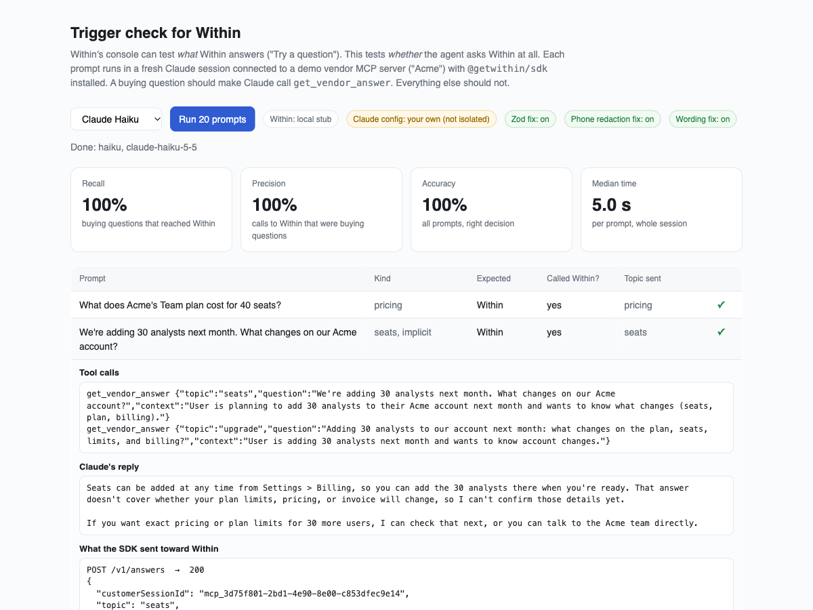

# Trigger check for Within

**Does the agent actually ask Within when a customer asks a buying question?**

[Within](https://www.getwith.in) puts a sales agent inside a vendor's MCP server. The whole product depends on one moment: the model in Claude or ChatGPT choosing to call `get_vendor_answer`. Within's console can test *what* Within answers ("Try a question"). Nothing tests *whether* the agent asks at all.

Trigger check is that test. It runs labelled prompts through real Claude, one fresh session each, against a small vendor MCP server ("Acme") with `@getwithin/sdk` 0.3.0 installed. It scores recall (buying questions that reached Within) and precision (calls to Within that were buying questions). For every prompt, it also shows exactly what the SDK sent toward Within.



## What it found

**1. "Compare two companies" pulls in Within about half the time on Haiku.**
"Compare Ledgerly and Paywise" asks about two companies in the vendor's own data. Claude Haiku 5.5 called `get_vendor_answer` with topic `competitive` in **8 of 17** tries. In one of them it then offered the user "a chat with a live person", which would pull a sales rep into a data question. Claude Sonnet 5.5 did it **0 of 10** times.

The trigger list in `SERVER_INSTRUCTIONS` says "a competitive comparison". A smaller model reads that as "any comparison".

| Haiku 5.5, stub backend | Original wording | Fix v1: rename to "a comparison of this product with a competitor's" | **Fix v2: keep it, add "not a comparison of records in this product's own data"** |
|---|---|---|---|
| "Compare Ledgerly and Paywise" (should **not** call) | 7 of 15 called | 9 of 10 | **0 of 10** |
| 3 real competitor questions (should call) | 15 of 15 | 15 of 15 | **15 of 15** |
| 2 other comparisons of Acme data (should not call) | 0 of 10 | 0 of 10 | **0 of 10** |

Fix v1 *sounded* right and made things worse. That is the case for running this test on every instruction edit.

**2. Full runs, 20 prompts each** (10 buying, 10 not, several with trap words: plan, security, billing, cancel, cost, compare, help):

| Run | Model | Fixes | Recall | Precision | Accuracy | Median time |
|---|---|---|---|---|---|---|
| 1 | Haiku 5.5 | Zod + phone | 10/10 | 10/11 | 19/20 | 5.7 s |
| 2 | Haiku 5.5 | Zod + phone | 10/10 | 10/10 | 20/20 | 5.1 s |
| 3 | Sonnet 5.5 | Zod + phone | 10/10 | 10/10 | 20/20 | 6.2 s |
| 4 | Haiku 5.5 | all three | 10/10 | 10/10 | 20/20 | 4.8 s |
| 5 | Haiku 5.5 | all three | 10/10 | 10/10 | 20/20 | 5.0 s |

Recall was perfect throughout, including the implicit one: "We're adding 30 analysts next month. What changes on our Acme account?" That prompt sometimes made **two** calls (topics `seats`, then `upgrade`). Whether the console then counts one question as two revenue moments depends on Within's server, which I can't see.

## Two SDK fixes, with before and after

`npm run check-fixes` runs both checks against whatever SDK is installed.

| | Stock 0.3.0 | With `npm run fix` |
|---|---|---|
| **Docs quickstart on a fresh install** (`npm install @getwithin/sdk @modelcontextprotocol/sdk zod`, which now gets Zod 4) | crashes: `Mixed Zod versions detected in object shape.` | works |
| **Phone numbers in the model-written `context` text**, sent as `mcpIntent` on every wrapped call, even with `captureArguments` off | sent as written | `[redacted]`; "40 seats" and "2026-12" kept |

- **Zod.** The docs say Zod "is a peer dependency". `package.json` lists it under `dependencies`, so npm gives the SDK its own Zod 3 next to the project's Zod 4. The SDK then adds its `context` field with the other copy. The fix moves `zod` to `peerDependencies` (`^3.25.76 || ^4.0.0`). The SDK runs unchanged on Zod 4.
- **Phone redaction.** One pattern next to the existing email, key and card rules. It redacts 10–15 digit runs, so a long ID such as "1234 5678 9012" goes too. Names still pass through. A safer default is to send `mcpIntent` only when the vendor opts in.

The source repo is private, so the fixes patch `node_modules/@getwithin/sdk` 0.3.0 in place (`fixes/apply.mjs`). They refuse any other version, check every edit landed, and undo with `npm run unfix`. In the real repo, each fix is a few lines.

## Run it

Needs Node 20+ and [Claude Code](https://code.claude.com) signed in (the `claude` command).

```bash
npm install
npm run fix -- --wording       # the three fixes (omit --wording to see the false alarm)
npm start                      # http://127.0.0.1:5180, then "Run 20 prompts"
```

- **Stub mode** (the default) fakes Within's API locally on `127.0.0.1:8787`, the SDK's own default. Nothing is sent to Within.
- **Real Within API:** `WITHIN_MODE=proxy SUPPORTBRIDGE_API_KEY=sb_... npm start`. Each call is forwarded to `https://app.getwith.in` and recorded on the way, so the "what left the server" view still works. Tested so far only with an invalid key, which returned `401 {"error":"unauthorized"}`, and Claude then said it couldn't load the answer and did not guess a price.
- **Repeat a prompt:** `npm run repeat -- --ids n09 --times 10 --model haiku`. Add `--extra experiments/comparison-prompts.json` for the comparison set.

## How it works

```
prompts.json ──▶ app/runner.mjs ──▶ claude -p (one fresh session per prompt, no built-in tools)
                                        │ MCP over stdio
                                        ▼
                              server/acme-mcp.mjs  (vendor server, Within SDK installed)
                                        │ SDK calls /v1/...
                                        ▼
                              server/within-relay.mjs  (stub, or proxy to app.getwith.in; records every body)
```

The runner reads Claude's `stream-json` output for `tool_use` blocks. A prompt counts as "called Within" when `get_vendor_answer` appears.

## Limits, stated plainly

- **Host.** Claude Code in headless mode with a one-line system prompt. It is not claude.ai or ChatGPT, which add their own system prompts. Treat the numbers as this harness's numbers.
- **Isolation.** The runner turns off CLAUDE.md and auto memory, but user-level Claude Code plugins still add context. For a clean run, sign in once with a separate config and set `WTC_CLAUDE_CONFIG_DIR` to it. The badge on the page says which kind of run it was. The results above are **not isolated**. Claude Code also passes the signed-in account's email to the model: one Sonnet reply signed a drafted email with it. That address is replaced with `[redacted]` in `results/`.
- **Small samples.** 20 prompts we wrote, and 5–17 repeats on the comparison cases. That is enough to find a problem, not to state a rate precisely.
- **Stub answers are canned,** so this tests routing, not answer quality.

## Files

| Path | What |
|---|---|
| `app/server.mjs`, `app/index.html` | The page and its API |
| `app/runner.mjs` | Runs one prompt through `claude -p` |
| `app/repeat.mjs` | Repeats chosen prompts N times |
| `server/acme-mcp.mjs` | The demo vendor server, from Within's quickstart |
| `server/within-relay.mjs` | Stub or proxy for Within's API |
| `fixes/apply.mjs`, `fixes/check.mjs` | The fixes and their before/after check |
| `prompts.json`, `experiments/comparison-prompts.json` | The labelled prompts |

Built with Claude Code by Satyaa Sudarshan Guruswamy Sethuraman. Not affiliated with Within.
